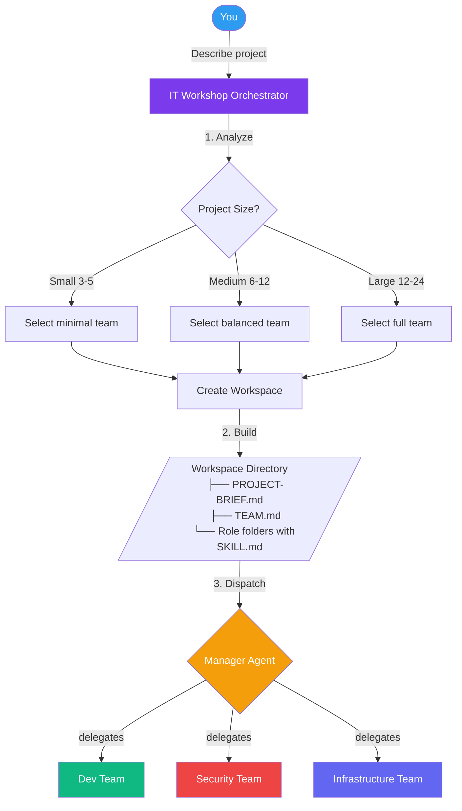
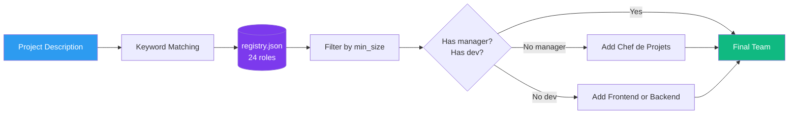
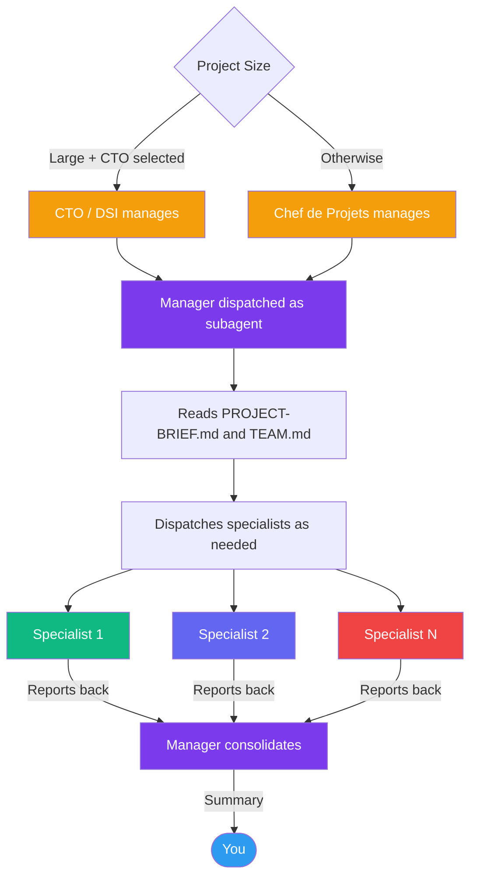

# IT Workshop

   

> **Spin up an entire IT project team in seconds.** Describe your project, and IT Workshop picks the right specialists from 24 agent roles, scaffolds a full workspace, and hands control to a manager agent who orchestrates the whole team.

A Claude Code skill that generates multi-agent IT project teams.

---

## What It Does

You tell it what you're building. It does the rest:

1. **Analyzes your project scope** — small, medium, or large
2. **Picks only the roles you need** from 24 IT specialists across 4 departments
3. **Creates a full workspace** — one folder per role with agent definitions, templates, and scripts
4. **Dispatches a manager agent** (CTO or Chef de Projets) who orchestrates the entire team
5. **You talk to the manager. The manager talks to everyone else.**

```
You: "I want to build a SaaS platform with user auth, payments, and a mobile app"

IT Workshop → Analyzes scope (large) → Selects 14 agents → Scaffolds workspace
           → Dispatches CTO as manager → CTO delegates to specialists
```

---

## Architecture



---

## The 24 Roles

Agents are organized into **4 departments**. The orchestrator picks only what your project needs.

### Direction & Management

| Role | Slug | What they do |
|------|------|-------------|
| **CTO / DSI** | `cto-dsi` | Strategic tech leadership. Manages large projects. |
| **Responsable SI** | `responsable-si` | IT systems oversight and governance. |
| **Chef de Projets** | `chef-de-projets` | Default project manager for small/medium teams. |
| **Scrum Master** | `scrum-master` | Agile facilitation, sprint planning, standups. |

### Development

| Role | Slug | What they do |
|------|------|-------------|
| **Tech Lead** | `tech-lead` | Technical architecture and code quality. |
| **UX/UI Designer** | `ux-ui-designer` | User experience, wireframes, design systems. |
| **Frontend Developer** | `frontend` | Client-side development (React, Vue, etc). |
| **Backend Developer** | `backend` | Server-side logic, APIs, databases. |
| **Mobile Developer** | `mobile-dev` | iOS/Android native and cross-platform. |
| **DevOps / SRE** | `devops-sre` | CI/CD, infrastructure as code, reliability. |
| **QA / Testeur** | `qa-testeur` | Testing strategy, automation, quality gates. |
| **DBA** | `dba` | Database design, optimization, migrations. |

### Cybersecurity

| Role | Slug | What they do |
|------|------|-------------|
| **RSSI / CISO** | `rssi-ciso` | Security strategy and risk management. |
| **Security Engineer** | `security-engineer` | Security architecture, hardening, tools. |
| **SOC Analyst** | `soc-analyst` | Threat monitoring, SIEM, alert triage. |
| **Pentester** | `pentester` | Vulnerability assessment, penetration testing. |
| **GRC / Compliance** | `grc-compliance` | Governance, risk, compliance (GDPR, ISO). |
| **Incident Response** | `incident-response` | Breach containment, forensics, recovery. |

### Infrastructure & Support

| Role | Slug | What they do |
|------|------|-------------|
| **Administrateur Réseau** | `admin-reseau` | Network architecture, firewalls, VPN. |
| **Sysadmin** | `sysadmin` | Server management, OS, core services. |
| **Cloud Engineer** | `cloud-engineer` | AWS/Azure/GCP, IaC, cost optimization. |
| **Support N1/N2** | `support-n1-n2` | First-line support, triage, knowledge base. |
| **Support N3 / Expert** | `support-n3-expert` | Deep troubleshooting, root cause analysis. |
| **Technicien Poste** | `technicien-poste` | Workstation deployment, endpoint security. |

---

## How Team Selection Works



Each role in the registry has **keywords** that map to project descriptions:

- Mention "mobile app" → `mobile-dev` gets selected
- Mention "authentication" or "security" → `security-engineer` joins
- Mention "cloud" or "AWS" → `cloud-engineer` is in
- Mention "CI/CD" or "deployment" → `devops-sre` activated

The orchestrator always ensures at least **one manager** and **one dev role** are present.

---

## Manager Dispatch



The manager agent is launched with:
- The project brief (scope, description, team)
- Each specialist's SKILL.md (their capabilities and templates)
- Authority to dispatch specialists as subagents

**You never talk to individual agents.** The manager handles all delegation and coordination.

---

## Workspace Structure

When IT Workshop runs, it creates this structure:

```
my-project/
├── PROJECT-BRIEF.md          # Project scope, description, team overview
├── TEAM.md                   # Team roster with roles and responsibilities
│
├── direction & management/
│   ├── CTO - DSI/
│   │   └── SKILL.md          # Agent definition + templates
│   ├── CHEF DE PROJECTS/
│   │   └── SKILL.md
│   └── ...
│
├── DEVELOPPEMENT/
│   ├── TECH LEAD/
│   │   └── SKILL.md
│   ├── FRONTEND/
│   │   └── SKILL.md
│   ├── BACKEND/
│   │   └── SKILL.md
│   └── ...
│
├── CYBERSECURITE/
│   ├── RSSI - CISCO/
│   │   └── SKILL.md
│   ├── PENTESTER/
│   │   └── SKILL.md
│   └── ...
│
└── INFRASTRUCTURE  & SUPPORT/
    ├── SYSADMIN/
    │   └── SKILL.md
    ├── COUD ENGINEER/
    │   └── SKILL.md
    └── ...
```

Each agent's `SKILL.md` contains:
- **Identity** — who they are and what they own
- **Responsibilities** — specific duties and deliverables  
- **Escalation rules** — who they report to
- **Workflow** — step-by-step working process
- **Templates** — ready-to-use document templates
- **Tools & scripts** — commands and utilities they use

---

## Installation

### Claude Code

```bash
# Clone into your skills directory
git clone https://github.com/ELPEDRU/it-workshop.git ~/.claude/skills/it-workshop
```

### Other Agents

Any agent that reads the [Agent Skills](https://agentskills.io) format can use this skill — copy the folder into that agent's skills directory.

---

## Usage

Once installed, just invoke the skill in Claude Code:

```
/it-workshop
```

Or describe a project and the skill triggers automatically:

```
"I need to build a fintech platform with real-time payments, 
 KYC verification, and a mobile app for iOS and Android"
```

The skill will:
1. Ask you to confirm the project name and description
2. Show you the proposed team for approval
3. Scaffold the full workspace
4. Launch the manager agent

---

## Example

**Input:**
> "Build an e-commerce marketplace with vendor management, payment processing, 
> real-time inventory, and a mobile app"

**IT Workshop selects (Large — 14 agents):**

| Department | Agents Selected |
|-----------|----------------|
| Direction | CTO/DSI, Chef de Projets, Scrum Master |
| Development | Tech Lead, UX/UI, Frontend, Backend, Mobile Dev, DevOps/SRE, QA, DBA |
| Security | Security Engineer |
| Infrastructure | Cloud Engineer, Support N1/N2 |

**Then:** CTO is dispatched as manager → delegates architecture to Tech Lead, UI to UX/UI Designer, API to Backend Developer, mobile to Mobile Dev, etc.

---

## File Overview

```
it-workshop/
├── SKILL.md                    # Main orchestrator entry point
├── README.md                   # You are here
├── LICENSE                     # MIT
├── roles/
│   ├── registry.json           # All 24 roles with keywords & metadata
│   ├── direction/              # 4 management role definitions
│   ├── developpement/          # 8 development role definitions
│   ├── cybersecurite/          # 6 security role definitions
│   └── infrastructure/         # 6 infrastructure role definitions
├── templates/
│   ├── PROJECT-BRIEF.md        # Project brief template
│   └── TEAM.md                 # Team roster template
└── scripts/
    └── scaffold.sh             # Workspace scaffolding script
```

24 role definitions + orchestrator + registry + 2 templates + scaffold script.

---

## How It's Built

- **Orchestrator pattern** — one SKILL.md entry point that reads the registry, selects roles, and dispatches the manager
- **Modular roles** — each of the 24 roles is an independent `.md` file with its own agent definition
- **JSON registry** — `registry.json` holds all role metadata (keywords, department, min_size, manager priority) for programmatic selection
- **Bash scaffold** — `scaffold.sh` creates the workspace directory structure using the registry
- **Template system** — `PROJECT-BRIEF.md` and `TEAM.md` use `{{PLACEHOLDER}}` substitution

---

## License

[MIT](LICENSE)

---

## Author

Built by **ELPEDRU** with Claude Code.
