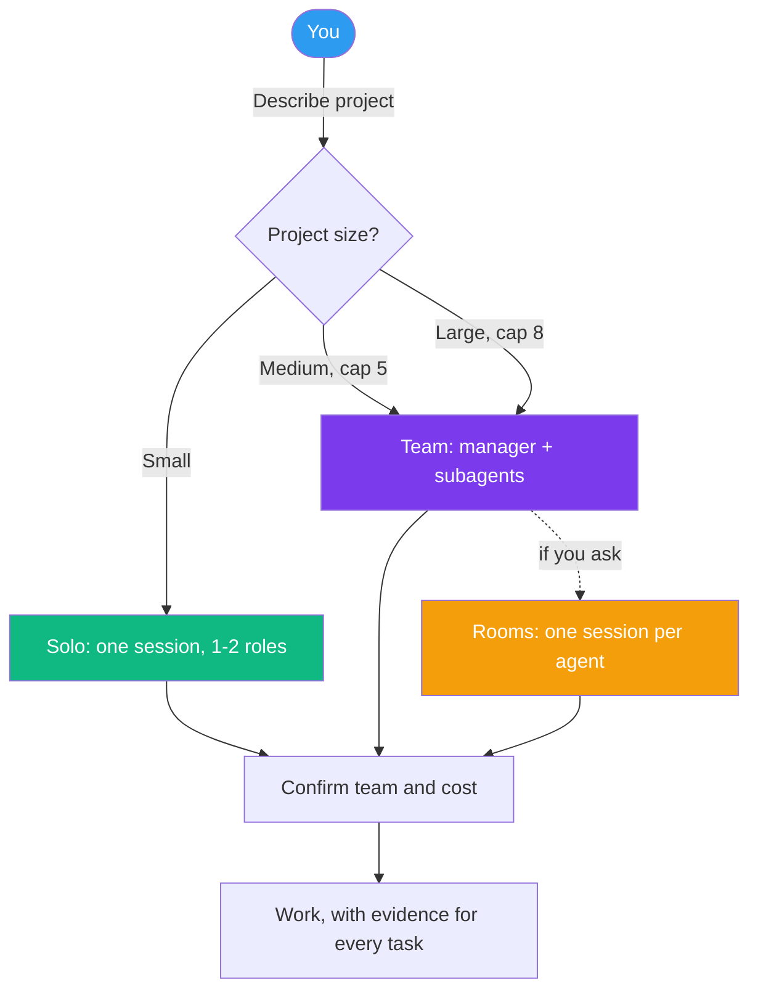
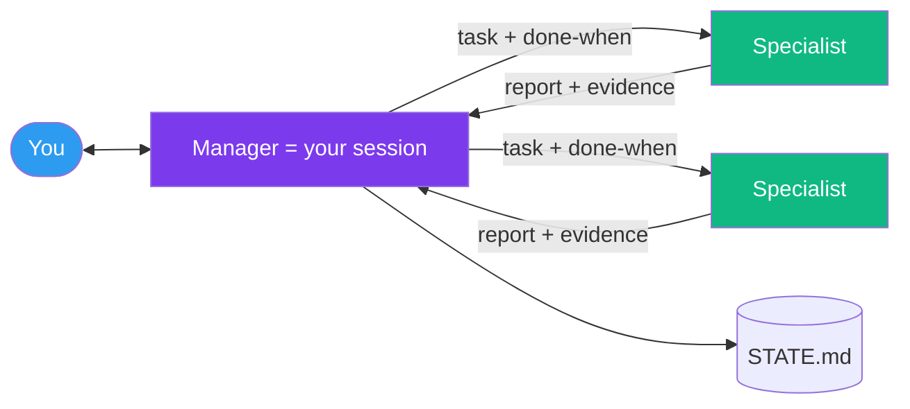

# IT Workshop

   

> **Spin up an entire IT project team in seconds.** Describe your project, and IT Workshop picks the smallest team that can deliver it from 24 agent roles, and runs it in the cheapest mode that fits.

A Claude Code skill that generates multi-agent IT project teams.

---

## What It Does

You tell it what you're building. It does the rest:

1. **Sizes your project** — small, medium, or large
2. **Picks only the roles you need** from 24 IT specialists across 4 departments, and tells you who was left out and why
3. **Shows you the plan and its cost** — how many agents and sessions — before anything starts
4. **Runs it in the right mode** — solo for small jobs, a managed team for bigger ones, a room per agent if you ask
5. **Keeps your project folder clean** — roles and skills stay in the skill folder
6. **Counts a task as done only with evidence** — files changed and a check that it works

```
You: "I want to build a SaaS platform with user auth, payments, and a mobile app"

IT Workshop → Sizes it (large) → Proposes 8 agents, asks you to confirm
           → Becomes the CTO → Dispatches specialists, 3 at a time
```

---

## Modes

Built to spend as few tokens as possible. The mode follows the project size, and you can override it.

| Mode | Used for | How it runs | Cost |
|------|----------|-------------|------|
| **Solo** | Small projects | One session does the work itself, wearing the right role | Lowest |
| **Team** | Medium and large projects | The session is the manager and dispatches subagents, 3 at a time | Medium |
| **Rooms** | Only when you ask | Every agent gets its own visible session in the sidebar | Highest |



Other token savers: the skill's own instructions are short and load the team rules only when a team is used, agents receive file paths instead of pasted content, each agent loads at most 2 skills and only when its task needs them, and reports are capped at 10 lines.

Say **"preview"** to see the proposed team and cost without creating anything.

---

## The 24 Roles

Agents are organized into **4 departments**. The orchestrator picks only what your project needs.

### Direction & Management

| Role | Slug | What they do |
|------|------|-------------|
| **CTO / DSI** | `cto-dsi` | Strategic tech leadership. Manages large projects. |
| **Responsable SI** | `responsable-si` | IT systems oversight and governance. |
| **Chef de Projets** | `chef-de-projets` | Default project manager for small/medium teams. |
| **Scrum Master** | `scrum-master` | Agile facilitation, sprint planning, standups. |

### Development

| Role | Slug | What they do |
|------|------|-------------|
| **Tech Lead** | `tech-lead` | Technical architecture and code quality. |
| **UX/UI Designer** | `ux-ui-designer` | User experience, wireframes, design systems. |
| **Frontend Developer** | `frontend` | Client-side development (React, Vue, etc). |
| **Backend Developer** | `backend` | Server-side logic, APIs, databases. |
| **Mobile Developer** | `mobile-dev` | iOS/Android native and cross-platform. |
| **DevOps / SRE** | `devops-sre` | CI/CD, infrastructure as code, reliability. |
| **QA / Testeur** | `qa-testeur` | Testing strategy, automation, quality gates. |
| **DBA** | `dba` | Database design, optimization, migrations. |

### Cybersecurity

| Role | Slug | What they do |
|------|------|-------------|
| **RSSI / CISO** | `rssi-ciso` | Security strategy and risk management. |
| **Security Engineer** | `security-engineer` | Security architecture, hardening, tools. |
| **SOC Analyst** | `soc-analyst` | Threat monitoring, SIEM, alert triage. |
| **Pentester** | `pentester` | Vulnerability assessment, penetration testing. |
| **GRC / Compliance** | `grc-compliance` | Governance, risk, compliance (GDPR, ISO). |
| **Incident Response** | `incident-response` | Breach containment, forensics, recovery. |

### Infrastructure & Support

| Role | Slug | What they do |
|------|------|-------------|
| **Administrateur Réseau** | `admin-reseau` | Network architecture, firewalls, VPN. |
| **Sysadmin** | `sysadmin` | Server management, OS, core services. |
| **Cloud Engineer** | `cloud-engineer` | AWS/Azure/GCP, IaC, cost optimization. |
| **Support N1/N2** | `support-n1-n2` | First-line support, triage, knowledge base. |
| **Support N3 / Expert** | `support-n3-expert` | Deep troubleshooting, root cause analysis. |
| **Technicien Poste** | `technicien-poste` | Workstation deployment, endpoint security. |

---

## How Team Selection Works

The skill reads one small table, [`roles/roles.tsv`](roles/roles.tsv): one line per role with its keywords and the smallest project size it makes sense for. Keywords are hints, not rules: a role joins only if the project really needs its job, you did not rule it out ("no mobile app"), and the team is still under its cap. There is always one manager and one development role.

Before starting, you see who was picked, who was left out, and why. You can force a role in or out.

---

## Skills

Each role has a short priority list of skills in [`roles/skills.txt`](roles/skills.txt). An agent uses the ones that are installed in your session, or the bundled copy when they are not, and loads at most 2 per task.

| Role | Example skills |
|------|----------------|
| Managers | `superpowers:writing-plans`, `superpowers:dispatching-parallel-agents` |
| Tech Lead | `engineering:architecture`, `engineering:code-review` |
| UX/UI Designer | `frontend-design`, `ui-ux-pro-max`, `high-end-visual-design` |
| Frontend | `frontend-patterns`, `shadcn-ui`, `vercel:nextjs`, the `gsap-*` suite |
| Backend | `backend-patterns`, `api-review`, `vercel:vercel-functions` |
| QA / Testeur | `playwright-dev`, `tdd-workflow`, `engineering:testing-strategy` |
| Security roles | `security-review`, `engineering:incident-response` |

### Bundled skills

72 skills ship inside this repo in [`skills/`](skills/), so the team works out of the box. If a skill is not installed on your machine, the agent reads the bundled copy instead. To install them all permanently:

```bash
bash ~/.claude/skills/it-workshop/scripts/install-skills.sh
```

---

## Credits

IT Workshop uses skills made by other people. I did not write them: they are included unchanged, each under its own original license, and all credit goes to their authors.

| Source | Author | License | Skills used |
|--------|--------|---------|-------------|
| [superpowers](https://github.com/obra/superpowers) | Jesse Vincent | MIT | 12 |
| [engineering](https://github.com/anthropics/knowledge-work-plugins) | Anthropic | Apache-2.0 | 10 |
| [anthropic-skills](https://github.com/anthropics/skills) | Anthropic | Apache-2.0 (per-skill LICENSE.txt) | 2 |
| [vercel](https://github.com/vercel/vercel-plugin) | Vercel | Apache-2.0 | 8 |
| [vercel-labs](https://github.com/vercel-labs/agent-skills) | Vercel Labs | MIT (stated in upstream README) | 2 |
| [gsap](https://github.com/greensock/gsap-skills) | GreenSock | MIT | 8 |
| [taste-skill](https://github.com/Leonxlnx/taste-skill) | Leonxlnx | MIT | 1 |
| [taste-skill-classics](https://github.com/Leonxlnx/taste-skill-classics) | Leonxlnx | MIT | 4 |
| [imagegen-skills](https://github.com/Leonxlnx/imagegen-skills) | Leonxlnx | MIT | 1 |
| [ui-ux-pro-max](https://github.com/nextlevelbuilder/ui-ux-pro-max-skill) | Next Level Builder | MIT | 1 |
| [emilkowalski](https://github.com/emilkowalski/skill) | Emil Kowalski | MIT | 1 |
| [minimax](https://github.com/MiniMax-AI/skills) | MiniMax | MIT | 2 |
| [everything-claude-code](https://github.com/affaan-m/everything-claude-code) | Affaan Mustafa | MIT | 7 |
| [playwright](https://github.com/microsoft/playwright) | Microsoft | Apache-2.0 | 6 |
| [orca](https://github.com/stablyai/orca) | Lovecast Inc. | MIT | 4 |
| [karpathy](https://github.com/forrestchang/andrej-karpathy-skills) | forrestchang | MIT (stated in upstream README) | 1 |
| [shadcn](https://github.com/shadcn-ui/ui) | shadcn | MIT | 1 |
| [shadcn-improve](https://github.com/shadcn/improve) | shadcn | MIT | 1 |

Full list per source: [`skills/README.md`](skills/README.md). The MIT license of this repo covers IT Workshop itself only, not the bundled skills.

---

## Team and Rooms



- In team and rooms mode, the session where you launch the skill **is the manager**. You talk to it there.
- Every task has one owner, a "done when", and the files it may touch. Parallel tasks never share files.
- Specialists report in 10 lines or fewer, with evidence. No evidence means the task goes back.
- In rooms mode each specialist runs in its own session named `<Role> — <project>`, which the Claude Code desktop app lists under the manager's session. Where that is not available, agents run as subagents.

---

## Project Folder

The project folder contains your project and nothing else:

```
my-project/
├── .workshop/
│   ├── PROJECT-BRIEF.md      # Scope, description, shared contracts
│   ├── TEAM.md               # Who is on the team, their role file and skills
│   └── STATE.md              # Tasks, status and evidence (lets you resume later)
└── ...                       # Your project: code, docs, assets
```

Role definitions and skills are never copied into the project. Each agent reads its role from `it-workshop/roles/` and its skills from where they are installed (or from `it-workshop/skills/`).

---

## Installation

### Claude Code

```bash
# Clone into your skills directory
git clone https://github.com/ELPEDRU/it-workshop.git ~/.claude/skills/it-workshop
```

### Other Agents

Any agent that reads the [Agent Skills](https://agentskills.io) format can use this skill — copy the folder into that agent's skills directory.

---

## Usage

Once installed, just invoke the skill in Claude Code:

```
/it-workshop
```

Or describe a project and the skill triggers automatically:

```
"I need to build a fintech platform with real-time payments, 
 KYC verification, and a mobile app for iOS and Android"
```

The skill will:
1. Size the project and propose a team
2. Show you the mode and the cost, and wait for your yes
3. Set up the project folder
4. Do the work (solo) or manage the team

Useful things to say: `preview`, `no <role>`, `add <role>`, `max 3 agents`, `use rooms`, `resume`.

---

## Example

**Input:**
> "Build an e-commerce marketplace with vendor management, payment processing, 
> real-time inventory, and a mobile app"

**IT Workshop proposes (large, team mode, capped at 8):**

| Department | Agents |
|-----------|--------|
| Direction | CTO/DSI |
| Development | Tech Lead, UX/UI, Frontend, Backend, Mobile Dev, DBA |
| Security | Security Engineer |

Left out: DevOps and QA (covered by Tech Lead and Backend for a first version). Add them back with `add devops-sre`.

---

## File Overview

```
it-workshop/
├── SKILL.md                    # Short orchestrator: intake, sizing, modes
├── references/
│   └── team-mode.md            # Manager rules, read only in team/rooms mode
├── roles/
│   ├── roles.tsv               # All 24 roles, one line each
│   ├── skills.txt              # Skills per role, in priority order
│   ├── direction/              # 4 management role definitions
│   ├── developpement/          # 8 development role definitions
│   ├── cybersecurite/          # 6 security role definitions
│   └── infrastructure/         # 6 infrastructure role definitions
├── skills/                     # Bundled third-party skills (own licenses)
├── templates/                  # PROJECT-BRIEF.md and TEAM.md
└── scripts/
    ├── team-skills.sh          # Skills for the selected roles
    ├── check.sh                # Validates the role table and skill list
    └── install-skills.sh       # Installs the bundled skills
```

To add a role: add a line to `roles/roles.tsv`, a line to `roles/skills.txt`, and a role file, then run `bash scripts/check.sh`.

---

## How It's Built

- **Short entry point** — `SKILL.md` stays small because it is loaded on every launch; team rules live in a reference file read only when needed
- **Plain tables instead of JSON** — no `jq`, works in Git Bash on Windows, and one `grep` returns only what the team needs
- **Scale to the job** — solo, team or rooms, chosen by project size
- **State on disk** — `.workshop/STATE.md` tracks tasks and evidence, so a project can be resumed
- **Clean project folder** — only `.workshop/` is added next to your files

---

## License

[MIT](LICENSE) for IT Workshop itself. Bundled skills keep their own licenses, see [Credits](#credits).

---

## Author

Built by **ELPEDRU**.

— ELPEDRU
