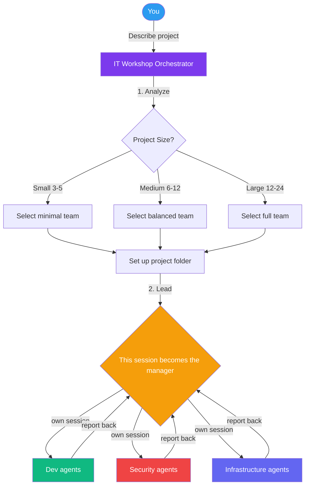
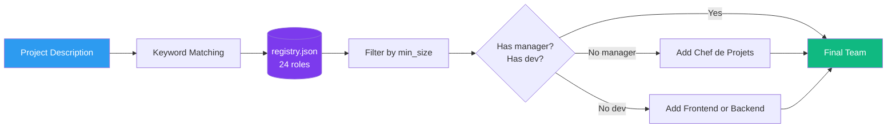
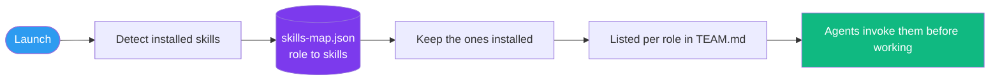
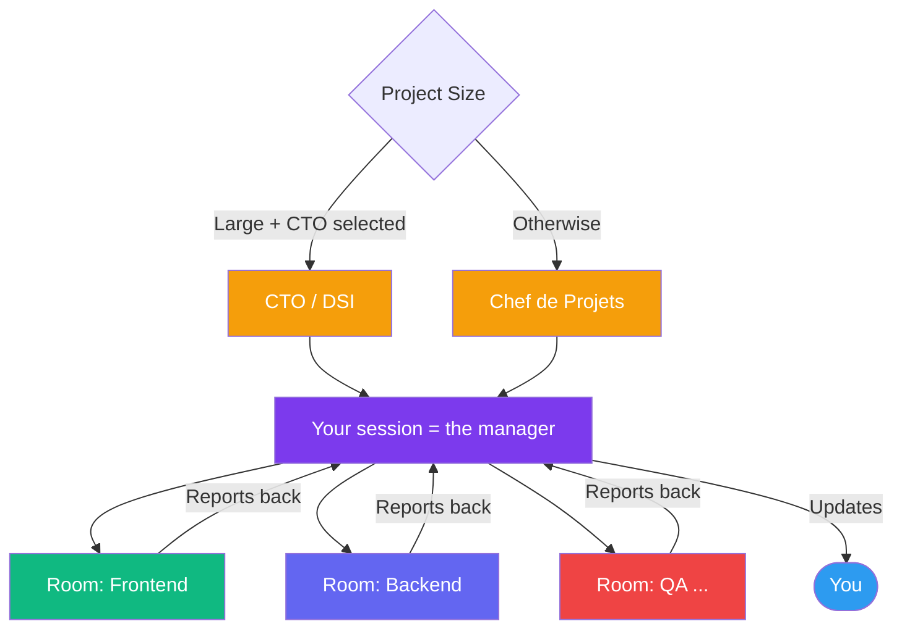

# IT Workshop

   

> **Spin up an entire IT project team in seconds.** Describe your project, and IT Workshop picks the right specialists from 24 agent roles, becomes the manager, and gives every agent its own session to work in.

A Claude Code skill that generates multi-agent IT project teams.

---

## What It Does

You tell it what you're building. It does the rest:

1. **Analyzes your project scope** — small, medium, or large
2. **Picks only the roles you need** from 24 IT specialists across 4 departments
3. **Detects every skill installed in your session** and hands each role the ones that fit its job
4. **Sets up a clean project folder** — only your project goes in it; roles and skills stay in the skill folder
5. **Becomes the manager** (CTO or Chef de Projets) in the session you are in
6. **Opens a room for every agent** — each specialist works in its own session in the sidebar, where you can watch it or talk to it

```
You: "I want to build a SaaS platform with user auth, payments, and a mobile app"

IT Workshop → Analyzes scope (large) → Selects 14 agents → Sets up the project folder
           → Becomes the CTO → Opens one session per specialist
```

---

## Architecture



---

## The 24 Roles

Agents are organized into **4 departments**. The orchestrator picks only what your project needs.

### Direction & Management

| Role | Slug | What they do |
|------|------|-------------|
| **CTO / DSI** | `cto-dsi` | Strategic tech leadership. Manages large projects. |
| **Responsable SI** | `responsable-si` | IT systems oversight and governance. |
| **Chef de Projets** | `chef-de-projets` | Default project manager for small/medium teams. |
| **Scrum Master** | `scrum-master` | Agile facilitation, sprint planning, standups. |

### Development

| Role | Slug | What they do |
|------|------|-------------|
| **Tech Lead** | `tech-lead` | Technical architecture and code quality. |
| **UX/UI Designer** | `ux-ui-designer` | User experience, wireframes, design systems. |
| **Frontend Developer** | `frontend` | Client-side development (React, Vue, etc). |
| **Backend Developer** | `backend` | Server-side logic, APIs, databases. |
| **Mobile Developer** | `mobile-dev` | iOS/Android native and cross-platform. |
| **DevOps / SRE** | `devops-sre` | CI/CD, infrastructure as code, reliability. |
| **QA / Testeur** | `qa-testeur` | Testing strategy, automation, quality gates. |
| **DBA** | `dba` | Database design, optimization, migrations. |

### Cybersecurity

| Role | Slug | What they do |
|------|------|-------------|
| **RSSI / CISO** | `rssi-ciso` | Security strategy and risk management. |
| **Security Engineer** | `security-engineer` | Security architecture, hardening, tools. |
| **SOC Analyst** | `soc-analyst` | Threat monitoring, SIEM, alert triage. |
| **Pentester** | `pentester` | Vulnerability assessment, penetration testing. |
| **GRC / Compliance** | `grc-compliance` | Governance, risk, compliance (GDPR, ISO). |
| **Incident Response** | `incident-response` | Breach containment, forensics, recovery. |

### Infrastructure & Support

| Role | Slug | What they do |
|------|------|-------------|
| **Administrateur Réseau** | `admin-reseau` | Network architecture, firewalls, VPN. |
| **Sysadmin** | `sysadmin` | Server management, OS, core services. |
| **Cloud Engineer** | `cloud-engineer` | AWS/Azure/GCP, IaC, cost optimization. |
| **Support N1/N2** | `support-n1-n2` | First-line support, triage, knowledge base. |
| **Support N3 / Expert** | `support-n3-expert` | Deep troubleshooting, root cause analysis. |
| **Technicien Poste** | `technicien-poste` | Workstation deployment, endpoint security. |

---

## How Team Selection Works



Each role in the registry has **keywords** that map to project descriptions:

- Mention "mobile app" → `mobile-dev` gets selected
- Mention "authentication" or "security" → `security-engineer` joins
- Mention "cloud" or "AWS" → `cloud-engineer` is in
- Mention "CI/CD" or "deployment" → `devops-sre` activated

The orchestrator always ensures at least **one manager** and **one dev role** are present.

---

## Skill Detection

IT Workshop does not work alone. At launch it lists every skill available in the session, then gives each agent the ones that match its role.



| Role | Example skills it picks up when installed |
|------|-------------------------------------------|
| Managers | `superpowers:brainstorming`, `superpowers:writing-plans`, `superpowers:subagent-driven-development` |
| Tech Lead | `engineering:architecture`, `engineering:code-review`, `pr-feedback-quality-gate` |
| UX/UI Designer | `ui-ux-pro-max`, `high-end-visual-design`, `motion-design` |
| Frontend | `shadcn-ui`, the `gsap-*` suite, `threejs`, `vercel:nextjs` |
| Backend | `backend-patterns`, `api-review`, `vercel:vercel-functions` |
| QA / Testeur | `playwright-dev`, `tdd-workflow`, `engineering:testing-strategy` |
| DevOps / SRE | `vercel:deploy`, `vercel:deployments-cicd`, `engineering:deploy-checklist` |
| Security roles | `security-audit`, `security-review`, `engineering:incident-response` |
| Everyone | `superpowers:verification-before-completion`, `karpathy-guidelines`, `coding-standards` |

The full map covers all 24 roles and lives in [`roles/skills-map.json`](roles/skills-map.json). Skills that are installed but not in the map are matched to roles by their description.

### Bundled skills

72 skills ship inside this repo in [`skills/`](skills/), so the team works out of the box. If a skill is not installed on your machine, the agent reads the bundled copy instead. To install them all permanently:

```bash
bash ~/.claude/skills/it-workshop/scripts/install-skills.sh
```

---

## Credits

IT Workshop uses skills made by other people. I did not write them: they are included unchanged, each under its own original license, and all credit goes to their authors.

| Source | Author | License | Skills used |
|--------|--------|---------|-------------|
| [superpowers](https://github.com/obra/superpowers) | Jesse Vincent | MIT | 12 |
| [engineering](https://github.com/anthropics/knowledge-work-plugins) | Anthropic | Apache-2.0 | 10 |
| [anthropic-skills](https://github.com/anthropics/skills) | Anthropic | Apache-2.0 (per-skill LICENSE.txt) | 2 |
| [vercel](https://github.com/vercel/vercel-plugin) | Vercel | Apache-2.0 | 8 |
| [vercel-labs](https://github.com/vercel-labs/agent-skills) | Vercel Labs | MIT (stated in upstream README) | 2 |
| [gsap](https://github.com/greensock/gsap-skills) | GreenSock | MIT | 8 |
| [taste-skill](https://github.com/Leonxlnx/taste-skill) | Leonxlnx | MIT | 1 |
| [taste-skill-classics](https://github.com/Leonxlnx/taste-skill-classics) | Leonxlnx | MIT | 4 |
| [imagegen-skills](https://github.com/Leonxlnx/imagegen-skills) | Leonxlnx | MIT | 1 |
| [ui-ux-pro-max](https://github.com/nextlevelbuilder/ui-ux-pro-max-skill) | Next Level Builder | MIT | 1 |
| [emilkowalski](https://github.com/emilkowalski/skill) | Emil Kowalski | MIT | 1 |
| [minimax](https://github.com/MiniMax-AI/skills) | MiniMax | MIT | 2 |
| [everything-claude-code](https://github.com/affaan-m/everything-claude-code) | Affaan Mustafa | MIT | 7 |
| [playwright](https://github.com/microsoft/playwright) | Microsoft | Apache-2.0 | 6 |
| [orca](https://github.com/stablyai/orca) | Lovecast Inc. | MIT | 4 |
| [karpathy](https://github.com/forrestchang/andrej-karpathy-skills) | forrestchang | MIT (stated in upstream README) | 1 |
| [shadcn](https://github.com/shadcn-ui/ui) | shadcn | MIT | 1 |
| [shadcn-improve](https://github.com/shadcn/improve) | shadcn | MIT | 1 |

Full list per source: [`skills/README.md`](skills/README.md). The MIT license of this repo covers IT Workshop itself only, not the bundled skills.

---

## Manager and Agent Rooms



- The session where you launch the skill **is the manager**. You talk to it there.
- Every specialist gets **its own session**, named `<Role> — <project>`. In the Claude Code desktop app these appear under the manager's session in the sidebar, so each agent has its own room you can open.
- Where separate sessions are not available, agents run as subagents inside the manager's session instead.
- Specialists report to the manager. The manager reviews, sends work back if needed, and keeps you updated.

---

## Project Folder

The project folder contains your project and nothing else:

```
my-project/
├── .workshop/
│   ├── PROJECT-BRIEF.md      # Scope, description, manager
│   └── TEAM.md               # Who is on the team, their role file and skills
└── ...                       # Your project: code, docs, assets
```

Role definitions and skills are never copied into the project. Each agent reads its role from `it-workshop/roles/` and its skills from where they are installed (or from `it-workshop/skills/`).

---

## Installation

### Claude Code

```bash
# Clone into your skills directory
git clone https://github.com/ELPEDRU/it-workshop.git ~/.claude/skills/it-workshop
```

### Other Agents

Any agent that reads the [Agent Skills](https://agentskills.io) format can use this skill — copy the folder into that agent's skills directory.

---

## Usage

Once installed, just invoke the skill in Claude Code:

```
/it-workshop
```

Or describe a project and the skill triggers automatically:

```
"I need to build a fintech platform with real-time payments, 
 KYC verification, and a mobile app for iOS and Android"
```

The skill will:
1. Ask you to confirm the project name and description
2. Show you the proposed team for approval
3. Detect your installed skills and assign them to roles
4. Set up the project folder
5. Become the manager and open a session for each agent

---

## Example

**Input:**
> "Build an e-commerce marketplace with vendor management, payment processing, 
> real-time inventory, and a mobile app"

**IT Workshop selects (Large — 14 agents):**

| Department | Agents Selected |
|-----------|----------------|
| Direction | CTO/DSI, Chef de Projets, Scrum Master |
| Development | Tech Lead, UX/UI, Frontend, Backend, Mobile Dev, DevOps/SRE, QA, DBA |
| Security | Security Engineer |
| Infrastructure | Cloud Engineer, Support N1/N2 |

**Then:** the session becomes the CTO → delegates architecture to Tech Lead, UI to UX/UI Designer, API to Backend Developer, mobile to Mobile Dev, etc.

---

## File Overview

```
it-workshop/
├── SKILL.md                    # Main orchestrator entry point
├── README.md                   # You are here
├── LICENSE                     # MIT
├── roles/
│   ├── registry.json           # All 24 roles with keywords & metadata
│   ├── skills-map.json         # Which skills each role uses
│   ├── direction/              # 4 management role definitions
│   ├── developpement/          # 8 development role definitions
│   ├── cybersecurite/          # 6 security role definitions
│   └── infrastructure/         # 6 infrastructure role definitions
├── skills/                     # Bundled third-party skills (own licenses)
│   ├── index.json              # Name → path of every bundled skill
│   └── README.md               # Credits and licenses
├── templates/
│   ├── PROJECT-BRIEF.md        # Project brief template
│   └── TEAM.md                 # Team roster template
└── scripts/
    ├── detect-skills.sh        # Lists installed skills
    └── install-skills.sh       # Installs the bundled skills
```

24 role definitions + orchestrator + registry + skill map + 2 templates + 2 scripts + 72 bundled skills.

---

## How It's Built

- **Orchestrator pattern** — one SKILL.md entry point that reads the registry, selects roles, becomes the manager and opens a session per agent
- **Modular roles** — each of the 24 roles is an independent `.md` file with its own agent definition
- **JSON registry** — `registry.json` holds all role metadata (keywords, department, min_size, manager priority) for programmatic selection
- **Skill map** — `skills-map.json` links each role to the skills it should use; detection keeps only the installed ones
- **Clean project folder** — only a small `.workshop/` folder (brief and team) is added next to your project files
- **Template system** — `PROJECT-BRIEF.md` and `TEAM.md` use `{{PLACEHOLDER}}` substitution

---

## License

[MIT](LICENSE) for IT Workshop itself. Bundled skills keep their own licenses, see [Credits](#credits).

---

## Author

Built by **ELPEDRU**.

— ELPEDRU
